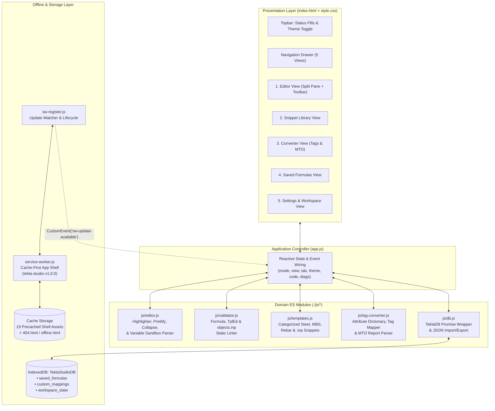
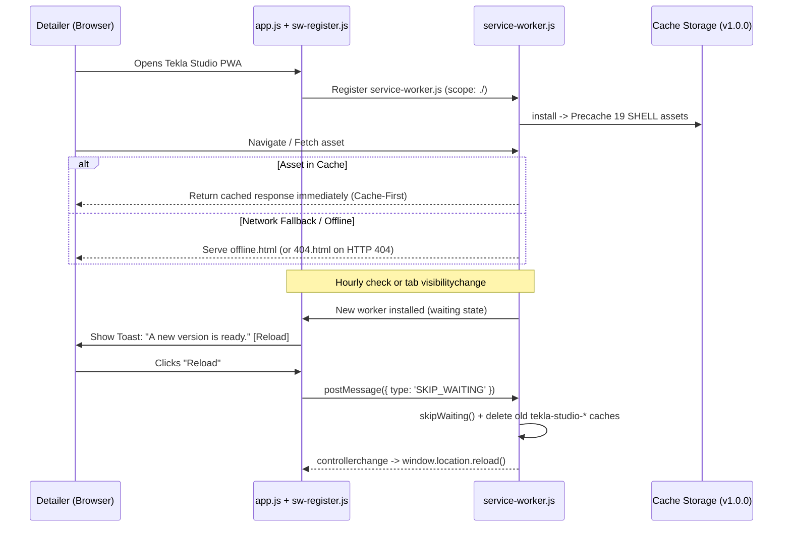

<div align="center">

  <!-- Project Logo (renders from your /icons directory) -->
  

  # 🏗️ Tekla Studio PWA: Formula, TplEd & .inp Workbench

  **An offline-first browser IDE and data-conversion workbench for Tekla Structures detailers to write, format, validate, test, and store Custom Component formulas, Template Editor (`TplEd`) scripts, `objects.inp` definitions, and Material Take-Off (MTO) data—with zero C#/.NET API integration required.**[cite: 4, 9, 12]

  <!-- Badges -->
  [](service-worker.js)
  [](manifest.webmanifest)
  [](app.js)
  [](privacy.html)
  [](index.html)
  [](LICENSE)

  <br />

  [🚀 Live Demo](#demo--visuals) · [📐 System Architecture](#system-architecture) · [⚡ Quick Start](#usage--quick-start) · [🐞 Report Issue](https://github.com/githubbest729/Tekla-Formula-TplEd-.inp-Studio/issues)

</div>

---

## 📑 Table of Contents

1. [Demo & Visuals](#-demo--visuals)
2. [Features ("Why This Project?")](#-features-why-this-project)
3. [System Architecture](#-system-architecture)
4. [Prerequisites & Requirements](#-prerequisites--requirements)
5. [Installation & Getting Started](#-installation--getting-started)
6. [Usage & Quick Start](#-usage--quick-start)
7. [Configuration](#-configuration)
8. [API & Module Documentation](#-api--module-documentation)
9. [Contributing](#-contributing)
10. [License](#-license)
11. [Authors & Acknowledgments](#-authors--acknowledgments)
12. [Support & Contact](#-support--contact)

---

## 🖥️ Demo & Visuals

> **Live Workbench URL:** `https://tekla-formula-tpled-inp-studio.vercel.app` *(Deploy to Vercel or Netlify at domain root)*[cite: 2, 8]

### Workbench Interface Layout

```text
+---------------------------------------------------------------------------------------------------+
| [img] Tekla Studio  Formula, TplEd and .inp Workbench            [Online] [Saved] [Theme: Dark]   |
+------------------+--------------------------------------------------------------------------------+
|                  | [Formula f(P1)] [TplEd rules] [objects.inp]   [Prettify] [Collapse & copy] ... |
|  > Editor        +---------------------------------------------+--+-------------------------------+
|    Snippet lib   | 1 | if (P1 > 300.0) then                    |  | [Diagnostics 0] [Sandbox]     |
|    Converter     | 2 |   ceil(P1 / P2) * 25.0                  |  | ----------------------------- |
|    Saved         | 3 | else                                    |  | P1: [ 450                 ]   |
|    Settings      | 4 |   150.0                                 |  | P2: [ 75                  ]   |
|                  | 5 | endif                                   |  | Output:                       |
|                  |                                             |  | +---------------------------+ |
|  Everything runs |                                             |  | | 150                       | |
|  in your browser.|                                             |  | +---------------------------+ |
|  Nothing is      +---------------------------------------------+--+-------------------------------+
|  uploaded.       | Custom Component Formula                                          Ln 5, Col 6  |
+------------------+--------------------------------------------------------------------------------+
```

| View | Preview Path | Description |
| :--- | :--- | :--- |
| **IDE & Live Sandbox** | `screenshots/editor-dark.png` | Split-pane syntax editor, real-time diagnostics, and live variable evaluator in CAD Blueprint Dark theme[cite: 3, 9]. |
| **Snippet Library** | `screenshots/snippets.png` | Filterable catalog of Steel, MBS, Rebar (AS3600 / ACI / BS8666), and `objects.inp` templates[cite: 4, 9]. |
| **Tag & MTO Converter** | `screenshots/converter.png` | Batch tag-to-attribute translator and raw `.xsr`/`.lis` report-to-CSV/Markdown sanitizer[cite: 4, 9]. |

---

## ✨ Features ("Why This Project?")

Tekla Structures' native Custom Component formula boxes and Template Editor (`TplEd`) value fields lack syntax highlighting, bracket matching, indentation formatting, and dry-run variable testing. **Tekla Studio PWA** solves this with a zero-integration companion IDE:

* **🎛️ Three Specialized Tekla Modes:** Switch seamlessly between **Custom Component Formulas (`f(P1)`)**, **Template Editor (`TplEd`) value field rules**, and **`objects.inp` UDA definitions**, keeping separate active buffers for each mode[cite: 4, 9].
* **↔️ One-Click Prettify & Collapse for Tekla Paste:** Expand cramped single-line Tekla equations into readable, indented multi-line `if / then / else / endif` blocks (`Ctrl+Shift+F`), then collapse them back into a single comment-stripped line and copy directly to your clipboard (`Ctrl+Shift+C`)[cite: 4, 9].
* **🔍 Real-Time Syntax & Rule Linter:** Automatically checks conditional block balance (`if`/`then`/`else`/`endif`), bracket/quote pairing, single `=` assignment typos inside conditions, division-by-zero risks, and 11-parameter `objects.inp` `attribute(...)` rules—with click-to-jump line navigation[cite: 4, 9].
* **🧪 Live Variable Sandbox:** Detects parametric variables (`P1`, `D1`) and `GetValue("...")` / `GetFieldFormula("...")` calls in your code and renders interactive test inputs so you can verify output values before pasting into Tekla[cite: 4, 9].
* **📚 Built-In Engineering Snippet Library:** Searchable templates covering Structural Steel connections, Metal Building Systems (MBS), Reinforced Concrete & Bar Bending Schedules (BBS), and `objects.inp` UDA tabs[cite: 4, 9].
* **🔄 Tag Translator & MTO Report Sanitizer:**
  * **Tag Translator:** Converts bracketed engineering tags like `[Assembly Mark]` or `[Main Part Profile]` into valid Tekla `GetValue("...")` calls using a built-in dictionary plus your own custom mappings[cite: 4, 9].
  * **MTO Sanitizer:** Parses messy fixed-width or delimited Tekla report output, trims headers/separators, removes duplicate rows, calculates total weight, and exports clean **CSV** or **Markdown** tables[cite: 4, 9].
* **🔒 100% Client-Side & Offline-First Privacy:** Zero cloud accounts, zero telemetry, and zero external requests[cite: 11]. All formulas, custom mappings, and workspace states persist locally in IndexedDB (`TeklaStudioDB`) with full `.json` backup export and import[cite: 4, 9, 11].

---

## 🏛️ System Architecture

### 1. High-Level Component & Data Flow Diagram

The application uses a modular, zero-dependency ES6 architecture orchestrated by `app.js`[cite: 4, 9] and backed by an offline-first Service Worker (`service-worker.js`)[cite: 5] and IndexedDB (`TeklaStudioDB`)[cite: 9, 11].



### 2. Service Worker Caching & Update Lifecycle

`service-worker.js`[cite: 5] and `sw-register.js`[cite: 6] implement a non-disruptive update flow so a detailer never loses unsaved formula edits mid-session[cite: 5]:



### 3. Internal ES Module Contracts

`app.js` communicates with the five domain modules inside `./js/` using strict, decoupled interfaces[cite: 4]:

| Module | Exported Symbols | Contract / Responsibility |
| :--- | :--- | :--- |
| **`js/editor.js`** | `createEditor({ host, sandbox, onChange, onCursor })` | Returns `{ getValue, setValue, setMode, getMode, prettify, collapse, setDiagnostics, goTo, insertAtCursor, focus }`[cite: 4]. Manages syntax highlighting (`.tok-*`), gutter line numbers, and the live Variable Sandbox[cite: 3, 4]. |
| **`js/validator.js`** | `validate(code, mode)` | Inspects `formula`, `tpled`, or `inp` code and returns an array of diagnostic objects: `[{ line, column, severity, message, fixSuggestion }]`[cite: 4]. |
| **`js/templates.js`** | `TEMPLATES`, `CATEGORIES` | Exports the static array of categorized engineering snippets (`[{ id, category, title, mode, description, code }]`) and category names[cite: 4]. |
| **`js/tag-converter.js`** | `translateTags`, `searchDictionary`, `parseReport`, `toCSV`, `toMarkdown` | Translates `[Tag]` tokens into Tekla attributes, queries the built-in + custom dictionary, parses raw MTO text reports into `{ headers, rows, summary }`, and serializes tables to CSV/Markdown[cite: 4]. |
| **`js/db.js`** | `default TeklaDB` | Asynchronous IndexedDB controller providing `init`, `loadWorkspace`, `saveWorkspace`, `listFormulas`, `putFormula`, `deleteFormula`, `listMappings`, `putMapping`, `deleteMapping`, `exportAll`, and `importAll(obj)`[cite: 4]. |

### 4. Repository File Tree

```text
/
├── index.html                  # Main PWA shell and 5 application views
├── offline.html                # Offline fallback page served by Service Worker
├── 404.html                    # Custom 404 error page for unknown routes
├── privacy.html                # Client-side zero-telemetry privacy policy
├── style.css                   # CAD Blueprint Dark & Light themes + responsive grid
├── app.js                      # Main application controller and event wiring
├── service-worker.js           # Cache-first Service Worker (tekla-studio-v1.0.0)
├── sw-register.js              # SW registration & non-intrusive update announcer
├── manifest.webmanifest        # Web App Manifest for desktop & mobile installability
├── workbox-config.js           # Optional Workbox CLI configuration for dist/ builds
├── browserconfig.xml           # Windows tile configuration
├── package.json                # Optional dev tooling scripts (serve / Workbox)
├── README.md                   # Project documentation
├── LICENSE                     # MIT License
├── js/
│   ├── editor.js               # Code editor, Prettify/Collapse formatter & Sandbox
│   ├── validator.js            # Tekla syntax, type & objects.inp rule validator
│   ├── templates.js            # Steel, MBS, Rebar & objects.inp snippet catalog
│   ├── tag-converter.js        # Attribute dictionary, tag mapper & MTO sanitizer
│   └── db.js                   # IndexedDB (TeklaStudioDB) persistence & JSON backup
├── icons/
│   ├── icon-192.png.svg        # 192x192 app icon
│   ├── icon-512.png.svg        # 512x512 app icon
│   ├── icon-maskable-192.png.svg
│   ├── icon-maskable-512.png.svg
│   ├── apple-touch-icon.png.svg
│   └── favicon.ico.svg
└── docs/
    └── ARCHITECTURE.md         # Detailed architectural notes
```

---

## 📋 Prerequisites & Requirements

* **Browser:** Any modern evergreen browser supporting ES6 Modules, `IndexedDB`, and `ServiceWorker` (Chrome/Edge 90+, Firefox 90+, Safari 15.4+)[cite: 6, 9, 11].
* **Runtime Dependencies:** **None.** The application runs in pure Vanilla HTML, CSS, and ES6+ JavaScript[cite: 3, 4, 9].
* **Local Development Server:** Because the app uses ES Modules (`<script type="module" src="app.js">`)[cite: 9] and registers a Service Worker over `https:` or `localhost`[cite: 6], you must serve the folder via a local HTTP server rather than opening `index.html` over the `file://` protocol[cite: 6, 9].

---

## 🚀 Installation & Getting Started

### 1. Clone the Repository

```bash
git clone [https://github.com/githubbest729/Tekla-Formula-TplEd-.inp-Studio.git](https://github.com/githubbest729/Tekla-Formula-TplEd-.inp-Studio.git)
cd Tekla-Formula-TplEd-.inp-Studio
```

### 2. Start a Local Web Server (Choose Any Option)

**Option A — Using Node.js (`npx serve`):**
```bash
npx serve . -l 3000
```

**Option B — Using Python 3:**
```bash
python -m http.server 8080
```

**Option C — Using VS Code Live Server:**
1. Open the repository folder in **Visual Studio Code**.
2. Right-click `index.html`[cite: 9] and select **Open with Live Server**.

### 3. Open the Workbench
Navigate to `http://localhost:3000` (or `http://localhost:8080`). Click the **Install App** icon in your browser's address bar to install **Tekla Studio** as a standalone desktop or mobile application[cite: 12].

---

## 💡 Usage & Quick Start

### 1. Format, Validate & Collapse a Custom Component Formula (`f(P1)`)
1. Open the **Editor** view and select **`Formula f(P1)`** in the mode switcher[cite: 9].
2. Paste a cramped single-line Tekla formula:
   ```text
   if (P1 > 300.0) then ceil(P1 / P2) * 25.0 else 150.0 endif
   ```
3. Click **Prettify** (`Ctrl+Shift+F`) to expand it into an indented multi-line block[cite: 4, 9]:
   ```text
   if (P1 > 300.0) then
     ceil(P1 / P2) * 25.0
   else
     150.0
   endif
   ```
4. Switch the right-hand pane to **Variable sandbox**[cite: 9], enter test values for `P1` and `P2`, and inspect the live calculated result[cite: 4, 9].
5. Click **Collapse and copy** (`Ctrl+Shift+C`) to strip line breaks/comments and copy the verified single-line string to your clipboard for pasting into Tekla Structures[cite: 4, 9].

### 2. Author & Lint `TplEd` Value Field Rules
1. Switch the editor mode to **`TplEd rules`**[cite: 9].
2. Write or load a Template Editor script from the **Snippet library**[cite: 9]:
   ```text
   if (GetValue("PROFILE.FLANGE_THICKNESS_1") >= 16.0) then
     GetValue("ASSEMBLY_POS") + " (HEAVY)"
   else
     GetValue("ASSEMBLY_POS")
   endif
   ```
3. Check the **Diagnostics** tab on the right[cite: 9]. Any unclosed `if` blocks, mismatched quotes, or type comparison warnings will appear with a clickable button that jumps your cursor directly to the exact line and column[cite: 4, 9].

### 3. Build `objects.inp` User-Defined Attributes (UDAs)
1. Switch the editor mode to **`objects.inp`**[cite: 9].
2. Load an `objects.inp` boilerplate from the **Snippet library** or write a custom `tab_page` definition[cite: 4, 9]. The validator automatically verifies parameter counts, duplicate UDA identifiers, and coordinate overlaps.

### 4. Translate Engineering Tags & Clean Raw MTO Reports
1. Open the **Converter** view from the left sidebar[cite: 9].
2. **Tag Translator Tab:** Paste text containing bracketed tags like `[Assembly Mark] - [Main Part Profile]` and click **Translate tags** to convert them into `GetValue("...")` expressions[cite: 4, 9]. Add company-specific tags under **Your custom mappings**[cite: 9].
3. **MTO Sanitizer Tab:** Paste raw fixed-width or delimited Tekla report output into the textarea and click **Clean report**[cite: 9]. The sanitizer strips headers/footers, deduplicates identical rows, totals the weight, and lets you export via **Download CSV**, **Copy CSV**, or **Copy Markdown**[cite: 4, 9].

### ⌨️ Keyboard Shortcuts

| Shortcut | Context | Action |
| :--- | :--- | :--- |
| `Ctrl + S` / `Cmd + S` | Editor View | Open the **Save formula** dialog[cite: 4, 9] |
| `Ctrl + Shift + F` | Editor View | **Prettify** formula into indented multi-line blocks[cite: 4, 9] |
| `Ctrl + Shift + C` | Editor View | **Collapse** formula to one line and copy to clipboard[cite: 4, 9] |
| `ArrowLeft` / `ArrowRight` | Split Divider Focused | Resize the code and side panel split width by 3% increments[cite: 4, 9] |
| `Escape` | Anywhere | Close mobile navigation drawer or modal dialog[cite: 4, 9] |

---

## ⚙️ Configuration

### 1. Theme Customization (`style.css`)
Tekla Studio includes two built-in engineering themes selectable from the topbar **Theme** button or **Settings** view[cite: 3, 4, 9]:
* **CAD Blueprint Dark (`data-theme="dark"`):** Default high-contrast slate background (`#0f172a`) with cyan (`#22d3ee`) and amber (`#fbbf24`) accents[cite: 3, 9].
* **Blueprint Light (`data-theme="light"`):** High-legibility daylight theme (`#f1f5f9`) for bright site offices or print screenshots[cite: 3, 9].

### 2. Service Worker Versioning (`service-worker.js`)
When deploying updates, increment the `VERSION` constant at the top of `service-worker.js`[cite: 5]:
```javascript
const VERSION = '1.0.0'; // Bump on every release (e.g., '1.0.1')
```
On activation, the new Service Worker automatically purges outdated `tekla-studio-v*` caches and prompts open tabs to reload via `sw-register.js`[cite: 5, 6].

### 3. Optional Workbox Precaching (`workbox-config.js`)
The repository ships with a zero-dependency hand-written `service-worker.js`[cite: 5, 7]. If you prefer a generated Workbox precache manifest, run[cite: 7]:
```bash
npx workbox-cli generateSW workbox-config.js
```
This outputs `dist/workbox-service-worker.js` without overwriting your root `service-worker.js`[cite: 7].

### 4. Root-Path Hosting Note
Standalone fallback pages (`404.html`, `offline.html`, and `privacy.html`) reference `/style.css` and `/icons/icon-192.png.svg` using root-relative paths so they resolve cleanly from any nested URL[cite: 8, 10, 11]. Host the app at a **domain root** (such as Vercel, Netlify, Cloudflare Pages, or a custom domain) rather than a subpath URL.

---

## 📖 API & Module Documentation

* **Architecture Reference:** See [`docs/ARCHITECTURE.md`](docs/ARCHITECTURE.md) for deep-dive parser, tokenizer, and IndexedDB schema details[cite: 7].
* **Privacy Policy:** See [`privacy.html`](privacy.html) for details on local-only browser storage (`TeklaStudioDB`) and workspace `.json` backups[cite: 11].

---

## 🤝 Contributing

Contributions from Tekla Structures detailers, BIM coordinators, and JavaScript developers are welcome!

1. **Fork** the repository (`githubbest729/Tekla-Formula-TplEd-.inp-Studio`)[cite: 2].
2. **Create a feature branch:**
   ```bash
   git checkout -b feat/new-rebar-snippets
   ```
3. **Add your enhancements:**
   * Add new Steel, MBS, or Rebar formulas to `js/templates.js`[cite: 4, 5].
   * Add new attribute mappings to `js/tag-converter.js`[cite: 4, 5].
   * Add new linting rules to `js/validator.js`[cite: 4, 5].
4. **Verify syntax & offline shell:** Ensure all snippets pass the built-in validator with zero errors and that any new static files are listed in `SHELL` inside `service-worker.js`[cite: 5].
5. **Commit and open a Pull Request:**
   ```bash
   git commit -m "feat(templates): add Eurocode 2 rebar lap length formula"
   git push origin feat/new-rebar-snippets
   ```

---

## 📄 License

Distributed under the **MIT License**. See [`LICENSE`](LICENSE) for full license text.

---

## ✍️ Authors & Acknowledgments

* **Author / Maintainer:** [@githubbest729](https://github.com/githubbest729)[cite: 2]
* **Built For:** Structural Steel, Metal Building Systems (MBS), and Reinforced Concrete Tekla Structures detailers and BIM engineers worldwide.

---

## 💬 Support & Contact

* **Bug Reports & Feature Requests:** [Open an Issue](https://github.com/githubbest729/Tekla-Formula-TplEd-.inp-Studio/issues)[cite: 2, 11]
* **Repository:** [github.com/githubbest729/Tekla-Formula-TplEd-.inp-Studio](https://github.com/githubbest729/Tekla-Formula-TplEd-.inp-Studio)[cite: 2]
